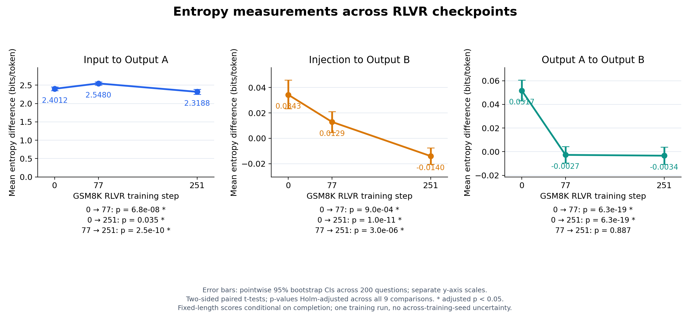

# Plasticity and Empowerment: context-ablation experiments

This repository studies how removing a question, a correction, or earlier output
changes a language model's next-token entropy. The experiments compare
three checkpoints within each of two GSM8K GRPO training lineages. These scores measure **entropy
sensitivity to context ablation**. They do not establish plasticity, formal
directed information, correction-following accuracy, or empowerment.

## Latest results: October 31, 2026, Qwen3-0.6B

The completed **200-question x 20-rollout x 3-checkpoint** experiment contains
12,000 raw rollouts and 600 question/checkpoint summaries. Means below are in
bits/token; brackets are pointwise 95% question-bootstrap confidence intervals.

| Measurement | Step 0 | Step 77 | Step 251 |
|---|---:|---:|---:|
| Input to Output A | 2.4012 [2.3511, 2.4511] | 2.5480 [2.5023, 2.5931] | 2.3188 [2.2533, 2.3855] |
| Injection to Output B | 0.0343 [0.0234, 0.0458] | 0.0129 [0.0046, 0.0211] | -0.0140 [-0.0204, -0.0075] |
| Output A to Output B | 0.0517 [0.0431, 0.0605] | -0.0027 [-0.0096, 0.0043] | -0.0034 [-0.0107, 0.0039] |



**Injection to Output B decreases at every stage**, consistent with the direction
in the earlier experiment. This supports a reduced-plasticity hypothesis through
an entropy proxy; correction-following behavior was not measured.

**Output A to Output B decreases early and then shows no detectable further
change.** Its final confidence interval includes zero. The earlier experiment's
increase was not significant after correction, so these results do not establish
a general reversal of empowerment. Differences between models, training, chat
framing, and question selection limit the comparison.

Read the [full results and explanation](results/qwen06b_gsm8k200_20rollouts/README.md)
for all nine comparisons, the original-50-question sensitivity check, completion
rates, audit findings, and commands to reproduce the analysis. The [raw data and
figures](results/qwen06b_gsm8k200_20rollouts), [200 questions and injections](data/gsm8k200),
[model setup](QWEN06B_EXPERIMENT.md), and [source snapshots and audit](provenance/qwen06b/README.md)
are included in the repository.

## Previous results: October 30, 2026, 1.7B

The completed run contains **50 screened GSM8K test questions × 20 sampled
rollouts × 3 checkpoints = 3,000 rollouts**. Each rollout attempts 20 tokens of
Output A, inserts the question-specific correction, then attempts 20 tokens of
Output B. Checkpoint 0 is already an SFT model, before the additional GRPO run.

Means below weight each question equally after averaging its available complete
rollouts. Units are bits per token; brackets are pointwise 95% question-bootstrap
intervals.

| Context ablated | Step 0 | Step 50 | Step 100 |
|---|---:|---:|---:|
| Prompt, when scoring A | 1.4987 [1.4222, 1.5813] | 1.6796 [1.5885, 1.7788] | 1.6964 [1.5731, 1.8282] |
| Correction, when scoring B | 0.3414 [0.3096, 0.3750] | 0.1232 [0.0866, 0.1630] | 0.0802 [0.0501, 0.1133] |
| Earlier output A, when scoring B | 0.0417 [0.0236, 0.0620] | 0.0581 [0.0467, 0.0704] | 0.0753 [0.0604, 0.0902] |

Prompt-ablation scores increase from step 0 to 100; correction-ablation scores
decrease. The earlier-output score increases numerically, but **none of its three
checkpoint comparisons passes the 0.05 threshold after Holm correction**. This
is not evidence that RLVR causes loss of plasticity or increased empowerment.


Full A+B completion rates are 98.0%, 94.7%, and 97.0%. Scores are conditional on
completion; early endings are missing values, not zeros. The questions were
screened for long Qwen responses, and these are checkpoints from one training
run. Uncertainty across independently trained models is not measured.

**Provenance limitation:** the historical run's recorded runner hash does not
match the source available at publication. Raw-data arithmetic and saved
summaries verify, but exact historical code identity is unresolved. See
[provenance](provenance/README.md).

Read [findings](FINDINGS.md) for all nine comparisons, robustness checks, and
lessons from earlier runs. [Methods](METHODS.md) defines the contexts and scores.

## Reproduce the analysis without loading a model

Python 3.10 or newer:

```sh
python3 -m pip install -r requirements-analysis.txt
python3 verify_results.py
python3 analyze_checkpoint_statistics.py
python3 plot_checkpoint_means.py
```

The verifier checks artifact hashes, the full rollout grid, dataset fields,
checkpoint revisions, seeds, entropy differences, missing-value handling, and
all question-level means/SDs/SEMs. Analysis uses 50,000 bootstrap draws and
question-paired t-tests, with Holm correction across nine primary comparisons.
The plot reads the regenerated interval table directly.

Published inputs are in [data/gsm8k50](data/gsm8k50/README.md). Raw rollouts,
question summaries, configuration, statistics, and figures are in
[results/sampled_rlvr_50x20](results/sampled_rlvr_50x20).

## Run a new experiment

```sh
python3 -m pip install -r requirements.txt
python3 -m unittest -v
python3 sampled_rlvr_experiment.py --output-dir runs/my-run
# Resume only this new run, with identical code and settings:
python3 sampled_rlvr_experiment.py --output-dir runs/my-run --resume
# Analyze a completed new run:
python3 analyze_checkpoint_statistics.py --results-dir runs/my-run
python3 plot_checkpoint_means.py --results-dir runs/my-run
```

Defaults are 50 questions, 20 rollouts each, pinned checkpoints, temperature 1,
full-softmax sampling, and EOS enabled. `--limit 1 --rollouts 1` provides a small
execution check, still loading all three models. Downloads and inference are
required for a new run. The runner uses Apple MPS when available, otherwise CPU;
its default output is gitignored under `runs/`. Do not resume the published
historical run with the edited runner. Device and library differences can change
sampled trajectories.

There is one supported inference entry point: `sampled_rlvr_experiment.py`.
[Cleanup notes](CLEANUP.md) explain which older scripts were retired and why.
