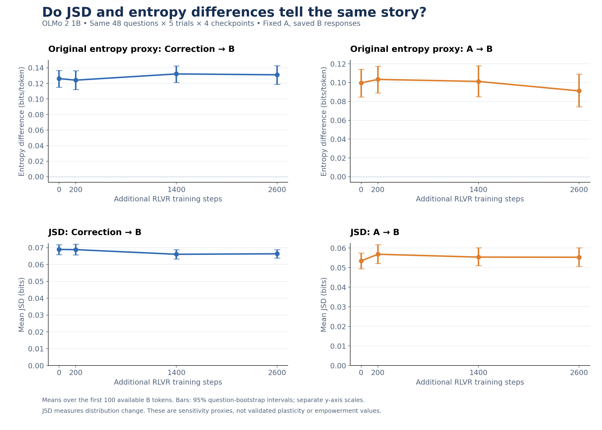
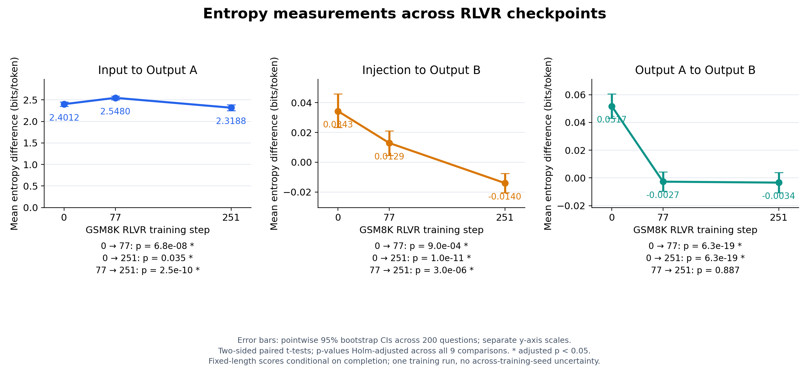

# Plasticity and Empowerment: context-ablation experiments

Updated November 10, 2026 · Research by Ray Shaw and Ben Calvert

We study whether reinforcement learning with verifiable rewards changes how
language models respond to corrections and rely on their earlier output.
Our latest experiments compare Qwen and OLMo checkpoints using both entropy
differences and Jensen–Shannon divergence (JSD).

**Current takeaway:** results depend on the model, response window, and metric.
We have not established a universal decrease in behavioral plasticity or increase
in empowerment. Distribution sensitivity and successful correction-following
must be measured separately.

We measure how a language model's next-token probabilities and entropy change when a
piece of context is removed: the question, a mid-response correction, or the
model's own earlier output. We compare checkpoints from GSM8K GRPO training runs
to see how these sensitivities change with additional RL training.

> **What the numbers mean.** "Plasticity" (sensitivity to a correction) and
> "empowerment" (sensitivity to earlier output) are working labels for
> **context sensitivity**, measured with signed entropy differences and JSD. They are not formal
> directed information, channel capacity, or correction-following accuracy.
> [docs/METHODS.md](docs/METHODS.md) defines every context and score.

## Latest findings

| Study | Evidence | Takeaway |
|---|---|---|
| Corrected whole-A Qwen run | 1,500 attempts; remove all A, score B75–125 | Both entropy-proxy means decrease; length-based exclusions differ by checkpoint. |
| OLMo with fresh A | 400 responses across four checkpoints | Correction entropy sensitivity fluctuates; A-related entropy sensitivity decreases in point estimates. |
| OLMo with fixed A | 993/1,000 saved; 960 matched responses analyzed | Holding A fixed controls source text; B still differs across checkpoints. |
| JSD versus entropy | Same 960 saved responses rescored | Endpoint directions differ by metric; all four endpoint-change intervals include zero. |
| Preliminary correction screen | 920 responses after source-issue exclusions | Seven confirmed old-value uses are a lower bound, not an exhaustive failure rate. |



[Full November 10 update](docs/updates/2026-11-10.md) ·
[JSD results and reproducible analysis](results/olmo2_fixed_a_jsd_20261109/README.md) ·
[OLMo results and preliminary grading](results/olmo2_1b_a100_full_b_50q_20261105/README.md) ·
[Ben's corrected whole-A results](results/qwen06b_original50_free_a125_whole_a_b75_125/README.md)

JSD captures probability changes even when entropy stays the same. Larger JSD
does not necessarily mean successful adaptation: a model can change its wording
or acknowledge a correction while calculating incorrectly. Our next proposed
step is to validate both metrics against correction adoption and answer accuracy,
with unchanged-fact and irrelevant-message controls.

## How an experiment works

1. **Prompt** the model with a GSM8K question and let it generate **Output A**.
2. **Inject** a question-specific correction (for example, "Actually, the price
   was $5, not $6").
3. Let the model generate **Output B**, and at each B position compare the
   entropy under the full context with the entropy after removing one source:

| Score | Context removed | Interpreted as |
|---|---|---|
| Input to Output A | the question | prompt sensitivity |
| Injection to Output B | the correction | "plasticity" |
| Output A to Output B | earlier output A | "empowerment" |

The JSD comparison uses the same two contexts and exact generated B history,
but compares their full next-token probability distributions. See
[measurement details](docs/METHODS.md#jsd-complement-november-2026).

## Repository layout

```
.
├── README.md                    You are here
├── QWEN06B_EXPERIMENT.md        Protocol: Qwen3-0.6B models, checkpoints, setup   (pinned, see below)
├── FIXED_A_OPENING.md           Protocol: fixed-A / supplied-opening follow-up    (pinned, see below)
│
├── docs/
│   ├── METHODS.md               Definitions of contexts, scores, and statistics
│   ├── FINDINGS.md              Full findings for the 1.7B study and earlier diagnostics
│   ├── CLEANUP.md               Which older scripts were retired, and why
│   └── updates/
│       └── 2026-11-02.md        Follow-up experiments: windows, audits, Daytona check
│
├── experiment_config.py         Pinned 1.7B checkpoints and default dataset
├── sampled_rlvr_experiment.py   Main inference runner (A → correction → B)
├── structured_calculation_experiment.py  Shared B-generation helpers
├── windowed_arithmetic_experiment.py     Follow-up runner: fixed A, arithmetic-only B50
├── sampled_a_arithmetic_experiment.py    Follow-up runner: fresh A, arithmetic-only B50
├── sampled_a_normal150_experiment.py     Follow-up runner: fresh A, normal correction, B150
├── sampled_a_arithmetic150_experiment.py UNRUN DRAFT, not used for any result
├── run_qwen06b_pipeline.py      End-to-end driver for the Qwen3-0.6B 200-question run
├── build_gsm8k200.py            Builds the 200-question dataset
├── verify_results.py            Audits saved results without loading a model
├── analyze_checkpoint_statistics.py  Bootstrap CIs, paired tests, Holm correction
├── plot_checkpoint_means.py     Checkpoint-means figure
│
├── configs/                     Model/checkpoint manifests (e.g. qwen06b_gsm8k200.json)
├── data/
│   ├── gsm8k50/                 50 screened questions + corrections (+ scripts/ to rebuild)
│   └── gsm8k200/                200-question superset used by the Qwen3-0.6B run
├── results/                     One folder per completed run (raw Parquet, stats, figures)
├── analysis/                    Analysis/plot scripts for the follow-up runs
├── provenance/                  Source snapshots, hash manifests, and audit records
├── daytona_pilot/               Cloud CPU speed-check controller (Daytona)
├── tests/                       Unit tests (no model downloads needed)
├── requirements.txt             Full inference environment
└── requirements-analysis.txt    Lightweight analysis-only environment
```

### Why some files stay at the top level

The runners at the repository root, `experiment_config.py`, `configs/`,
`FIXED_A_OPENING.md`, and `QWEN06B_EXPERIMENT.md` are **pinned by SHA-256 hash and
path** in `provenance/` manifests, and hashed result READMEs link to them. Their
current contents byte-match the code that produced the published results. Do not
move or edit them, and do not move files under `data/` or `results/`. If you need
to change a runner, add a new file and record new provenance for any new run.

## Experiment index

Listed newest first. Entropy differences are in bits/token; JSD is mean per-token divergence in bits.

| Date | Experiment | Model / checkpoints | Runner | Results | Write-up |
|---|---|---|---|---|---|
| 2026-11-10 | Preliminary full-B correction-value screen | OLMo 2 1B, 920 screened responses | `analysis/olmo_jsd/audit_injection_mentions.py` | [screen](results/olmo2_fixed_a_jsd_20261109/analysis/injection_value_screen) | [update](docs/updates/2026-11-10.md) |
| 2026-11-09 | JSD rescore, 960 matched saved responses | OLMo 2 1B, steps 0/200/1400/2600 | archived scorer + `analysis/olmo_jsd/` | [results](results/olmo2_fixed_a_jsd_20261109/README.md) | [update](docs/updates/2026-11-10.md) |
| 2026-11-06–07 | Fixed-A five-trial run, stopped at 993/1,000 | OLMo 2 1B | archived source | [results](results/olmo2_1b_fixed_step0_a_50q_5trials_20261106/README.md) | [update](docs/updates/2026-11-10.md) |
| 2026-11-05 | Fresh A100, B to EOS/cap, 400 responses | OLMo 2 1B | archived source | [results](results/olmo2_1b_a100_full_b_50q_20261105/README.md) | [update](docs/updates/2026-11-10.md) |
| 2026-11-03 | Corrected whole-A removal, B75–125 | Qwen3-0.6B, steps 0/77/251 | `daytona_for_ben/` | [results](results/qwen06b_original50_free_a125_whole_a_b75_125/README.md) | [update](docs/updates/2026-11-10.md) |
| 2026-11-02 | Daytona CPU speed check, late-A protocol (1 question) | Qwen3-0.6B, steps 0/77/251 | `daytona_pilot/` | [results/daytona_cpu_speed_check_late_a](results/daytona_cpu_speed_check_late_a/README.md) | [update](docs/updates/2026-11-02.md) |
| 2026-11-02 | Fresh A, normal correction, B windows up to 150 tokens | Qwen3-0.6B | `sampled_a_normal150_experiment.py` | [results/qwen06b_sampled_a_normal_150](results/qwen06b_sampled_a_normal_150) | [update](docs/updates/2026-11-02.md) |
| 2026-11-02 | Fresh A, arithmetic-only B50 | Qwen3-0.6B | `sampled_a_arithmetic_experiment.py` | [results/qwen06b_sampled_a_arithmetic_50](results/qwen06b_sampled_a_arithmetic_50) | [update](docs/updates/2026-11-02.md) |
| 2026-11-02 | Fixed A, arithmetic-only B50 | Qwen3-0.6B | `windowed_arithmetic_experiment.py` | [results/qwen06b_fixed_a_arithmetic_50](results/qwen06b_fixed_a_arithmetic_50) | [update](docs/updates/2026-11-02.md) |
| 2026-11-02 | Fixed A, no supplied opening (control) | Qwen3-0.6B | `sampled_rlvr_experiment.py` | [results/qwen06b_original50_fixed_a_no_opening](results/qwen06b_original50_fixed_a_no_opening) | [update](docs/updates/2026-11-02.md) |
| 2026-11-02 | B-length pilot (5 questions) | Qwen3-0.6B | `results/b_length_pilot/run_pilot.py` | [results/b_length_pilot](results/b_length_pilot) | [update](docs/updates/2026-11-02.md) |
| 2026-11-01 | Fixed A + "The calculation is" opening | Qwen3-0.6B | `sampled_rlvr_experiment.py` | [results/qwen06b_original50_fixed_a_calculation](results/qwen06b_original50_fixed_a_calculation/README.md) | [FIXED_A_OPENING.md](FIXED_A_OPENING.md) |
| 2026-10-31 | **200 questions × 20 rollouts × 3 checkpoints** | Qwen3-0.6B, steps 0/77/251 | `run_qwen06b_pipeline.py` | [results/qwen06b_gsm8k200_20rollouts](results/qwen06b_gsm8k200_20rollouts/README.md) | [QWEN06B_EXPERIMENT.md](QWEN06B_EXPERIMENT.md) |
| 2026-10-30 | **50 questions × 20 rollouts × 3 checkpoints** | 1.7B SFT → GRPO, steps 0/50/100 | `sampled_rlvr_experiment.py` | [results/sampled_rlvr_50x20](results/sampled_rlvr_50x20) | [FINDINGS.md](docs/FINDINGS.md) |
| earlier | Directed-information and answer-level diagnostics | various | retired, see [CLEANUP.md](docs/CLEANUP.md) | [results/earlier_diagnostics](results/earlier_diagnostics/README.md) | [FINDINGS.md](docs/FINDINGS.md) |

## Key results

### Qwen3-0.6B, 200 questions (October 31, 2026)

12,000 rollouts; means with pointwise 95% question-bootstrap confidence intervals.

| Measurement | Step 0 | Step 77 | Step 251 |
|---|---:|---:|---:|
| Input to Output A | 2.4012 [2.3511, 2.4511] | 2.5480 [2.5023, 2.5931] | 2.3188 [2.2533, 2.3855] |
| Injection to Output B | 0.0343 [0.0234, 0.0458] | 0.0129 [0.0046, 0.0211] | -0.0140 [-0.0204, -0.0075] |
| Output A to Output B | 0.0517 [0.0431, 0.0605] | -0.0027 [-0.0096, 0.0043] | -0.0034 [-0.0107, 0.0039] |



- **Injection to Output B decreases at every stage**, matching the direction seen
  in the 1.7B study. That fits a reduced-plasticity hypothesis via an entropy
  proxy; correction-following behavior was not measured.
- **Output A to Output B drops early and then shows no detectable change**; its
  final interval includes zero. This does not establish a general reversal of
  empowerment.

### Follow-ups (November 2, 2026)

Five further 1,500-evaluation runs on the original 50 questions vary whether A is
fixed or fresh, the B opening, and the B window length. Highlights:

- Supplying "The calculation is" as a B opening materially changes the
  earlier-output pattern. The choice of opening matters.
- With the normal correction and 150-token B windows, correction sensitivity
  decreases in every window. Earlier-output sensitivity rises numerically in
  later windows, but checkpoints retain very different response populations
  (273, 473, and 482 of 500 complete), so means compare selected subsets.
- Behavioral audits (correction-value mentions, EOS-only answer grading, opening
  length) are heuristic diagnostics, not validated accuracy.

Details, figures, and caveats are in [docs/updates/2026-11-02.md](docs/updates/2026-11-02.md).

### 1.7B, 50 questions (October 30, 2026)

| Context ablated | Step 0 | Step 50 | Step 100 |
|---|---:|---:|---:|
| Prompt, when scoring A | 1.4987 [1.4222, 1.5813] | 1.6796 [1.5885, 1.7788] | 1.6964 [1.5731, 1.8282] |
| Correction, when scoring B | 0.3414 [0.3096, 0.3750] | 0.1232 [0.0866, 0.1630] | 0.0802 [0.0501, 0.1133] |
| Earlier output A, when scoring B | 0.0417 [0.0236, 0.0620] | 0.0581 [0.0467, 0.0704] | 0.0753 [0.0604, 0.0902] |

Correction sensitivity decreases. The earlier-output score rises numerically,
but **none of its checkpoint comparisons survives Holm correction**. The
historical runner hash for this run does not match the published source; see
[provenance](provenance/README.md). Full analysis is in [docs/FINDINGS.md](docs/FINDINGS.md).

### Limitations common to all studies

Checkpoints come from single training lineages, so variation across
independently trained models is not measured. Question selection includes length screening in the original 50-question cohort.
Earlier Qwen complete-window analyses exclude short responses; the newer OLMo
available-token analyses retain them. Both policies have limits: exclusion changes
coverage, while available-token means can average different response lengths.
Missing scores are never converted to zeros.

## Daytona setup

[Daytona Code For Ben](daytona_for_ben/README.md) documents the corrected whole-A
Qwen runner. Historical run snapshots are preserved separately; do not resume a
published run with edited code.

## Quick start

### Reproduce the published analysis (no model download)

Requires Python 3.10+.

```sh
python3 -m pip install -r requirements-analysis.txt
python3 verify_results.py                 # audit hashes, rollout grid, entropy arithmetic
python3 analyze_checkpoint_statistics.py  # bootstrap CIs + Holm-corrected paired tests
python3 plot_checkpoint_means.py          # regenerate the checkpoint figure
```

These default to the 1.7B results in `results/sampled_rlvr_50x20`. Pass
`--results-dir` to point at another result folder. Note that the analysis script
rewrites files in that folder.

To rerun a follow-up analysis, copy its bundle into the gitignored `runs/`
directory first (the analysis scripts read from there):

```sh
mkdir -p runs && cp -R results/qwen06b_sampled_a_normal_150 runs/
python3 analysis/sampled_a_normal150_control/analyze_results.py
```

### Run the tests

```sh
python3 -m pip install -r requirements.txt
python3 -m unittest -v
```

Tests live in `tests/` and use tiny mock models, so they need no downloads.

### Run a new experiment

```sh
python3 sampled_rlvr_experiment.py --output-dir runs/my-run
python3 sampled_rlvr_experiment.py --output-dir runs/my-run --resume   # same code + settings only
python3 analyze_checkpoint_statistics.py --results-dir runs/my-run
python3 plot_checkpoint_means.py --results-dir runs/my-run
```

The defaults are 50 questions, 20 rollouts, the pinned 1.7B checkpoints,
temperature 1, and EOS enabled. Use `--experiment-config
configs/qwen06b_gsm8k200.json` for the Qwen3-0.6B models, or `--limit 1
--rollouts 1` for a quick smoke test (this still loads all three models). The
runner uses Apple MPS when available, otherwise CPU, and writes to the gitignored
`runs/` directory. Never `--resume` a published historical run with edited code.
