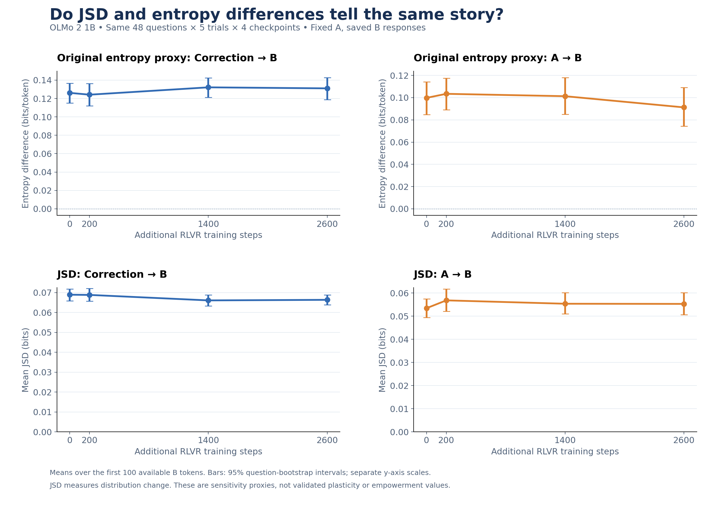

# Research update — November 10, 2026

The latest work tests how robust our context-sensitivity findings are to model
choice, fixed versus freely generated earlier output, and the scoring metric.
**We have not established a general relationship in which RLVR reduces
behavioral plasticity and increases empowerment.** These remain research hypotheses.
Ben Calvert's corrected Qwen run and Ray Shaw's subsequent OLMo analyses are
published here alongside the earlier studies.

## Corrected whole-A Qwen experiment

Ben completed the run on November 3 and pushed the result bundle November 4.
There are 1,500 attempts: 50 questions × 10 trials × steps 0/77/251. Each checkpoint
generates a fresh A capped at 125 tokens; the original correction arrives as a
new user message. Both scores target B positions 75–125 inclusive (51 tokens).
The earlier-output baseline now removes **all A1–125**, rather than only A75–125.

| Step | Eligible / attempted | Questions represented | Correction entropy difference | Earlier-output entropy difference |
|---|---:|---:|---:|---:|
| 0 | 343 / 500 | 46 / 50 | 0.01861 | 0.04066 |
| 77 | 485 / 500 | 50 / 50 | 0.01055 | 0.03158 |
| 251 | 495 / 500 | 50 / 50 | −0.00602 | 0.03031 |

Both point estimates decrease. These are not significance claims. Early-EOS
exclusions differ substantially across checkpoints. Restricting to the 46
represented baseline questions barely changes the means, but does not remove
selection among trials. Ben's original result bundle is preserved unchanged.
[Protocol, raw rollouts and coverage](../../results/qwen06b_original50_free_a125_whole_a_b75_125/README.md).

## OLMo 2 1B: freely generated A

We completed 400 responses: 50 questions × 2 trials × four checkpoints. Step 0
is the already-trained OLMo DPO checkpoint; steps 200, 1400 and 2600 are pinned
OLMo RLVR1 revisions. These are frozen checkpoint evaluations, not training runs
performed by this repository. Each checkpoint generates its own A up to 100
tokens. B can continue to EOS, with a 2,048-token safety cap. Entropy scores use
the first 100 available non-EOS B tokens and remove all available A for the
A-ablation comparison. Short responses remain eligible when there are scored tokens.

| Step | Correction entropy difference | Earlier-output entropy difference | Corrected-answer numerical matches / graded |
|---|---:|---:|---:|
| 0 | 0.12904 | 0.11362 | 48 / 94 (51.1%) |
| 200 | 0.12107 | 0.10656 | 53 / 94 (56.4%) |
| 1400 | 0.13920 | 0.10160 | 51 / 94 (54.3%) |
| 2600 | 0.13249 | 0.08890 | 50 / 91 (54.9%) |

Correction sensitivity fluctuates, while earlier-output sensitivity decreases
in its point estimates. Numerical matches are preliminary: source-key issues
and unresolved responses are excluded, and numeric matching is not a full
reasoning or semantic evaluation. These are **not standard GSM8K accuracies**.
Different models, checkpoints, framing, and response windows prevent a clean
causal model-family comparison with Qwen.
[Results and graphs](../../results/olmo2_1b_a100_full_b_50q_20261105/README.md).

## OLMo fixed-A control and JSD rescore

We held the exact saved step-0 A token IDs fixed for each question/trial across
checkpoints, while B was still generated separately. The planned 1,000-response
run stopped at the user's request after preliminary results, with 993 responses
saved (250/250/250/243). Because stopping followed inspection of results, the
analyses are exploratory, not a preregistered confirmatory test.

The balanced comparison uses 48 fully completed questions × 5 trials × 4
checkpoints = **960 responses**. Two incomplete questions are omitted at every
checkpoint. This omission is separate from the two source-issue exclusions in
the behavioral screen below. Exact A equality across checkpoints is checked in
publication validation. B can reach EOS or the 2,048-token cap; only its first
100 available non-EOS tokens are scored (31–100 in the matched set).

On November 9 we teacher-forced those same saved B sequences and computed
Jensen–Shannon divergence across the full next-token vocabulary. No new answers
were generated. At each position, all compared contexts receive the same B
history. The correction baseline empties the correction content; the A baseline
empties all A content. Message framing is retained.

- Entropy difference: **how much does including this source reduce uncertainty?**
- JSD: **how much does including this source change the probability distribution?**

| Measurement | Step 0 | Step 200 | Step 1400 | Step 2600 |
|---|---:|---:|---:|---:|
| Correction entropy difference | 0.12614 | 0.12416 | 0.13214 | 0.13104 |
| Earlier-output entropy difference | 0.09976 | 0.10341 | 0.10127 | 0.09122 |
| Correction JSD | 0.06896 | 0.06886 | 0.06610 | 0.06638 |
| Earlier-output JSD | 0.05343 | 0.05682 | 0.05536 | 0.05529 |

Entropy differences are in bits/token. JSD is the mean per-token divergence in
bits (base-2 logs, bounded between 0 and 1 per position); absolute magnitudes of
the two metrics are not interchangeable.

| Measurement | Step 2600 − step 0 | Paired 95% interval |
|---|---:|---:|
| Correction entropy difference | +0.004901 | [-0.006323, +0.016100] |
| Earlier-output entropy difference | -0.008541 | [-0.021698, +0.005550] |
| Correction JSD | -0.002577 | [-0.005328, +0.000230] |
| Earlier-output JSD | +0.001862 | [-0.001741, +0.005415] |

All four endpoint-change intervals include zero. Correction JSD decreases about
3.7% and A-related JSD increases about 3.5% in their endpoint point estimates,
but neither establishes the hypothesized training effect. Entropy differences
have opposite endpoint directions. Equal uncertainty can accompany different
token probabilities, so disagreement is possible without an implementation error.

Each response is averaged over its scored tokens, then trials are averaged
within questions, then questions are weighted equally. Intervals use 10,000
paired question-cluster bootstrap resamples; they are pointwise and unadjusted.
They capture variation across these questions, not across independent training
runs. Recomputed entropy matched saved values to within 0.000039 bits.
[Fixed-A raw responses](../../results/olmo2_1b_fixed_step0_a_50q_5trials_20261106/README.md) ·
[JSD scores, intervals and reproduction](../../results/olmo2_fixed_a_jsd_20261109/README.md).

## Preliminary correction-following screen

We screened full saved B text for original and revised values in the 960 matched
responses, excluding two questions with flagged source issues. This leaves
920 responses, 230 per checkpoint. We manually inspected the ten responses
without a revised-value match; the other 910 have not received comprehensive
semantic review.

| Step | Confirmed continued use of original value | Other incorrect substituted value | Revised value mentioned somewhere |
|---|---:|---:|---:|
| 0 | 1 / 230 | 1 / 230 | 228 / 230 |
| 200 | 4 / 230 | 1 / 230 | 225 / 230 |
| 1400 | 1 / 230 | 0 / 230 | 229 / 230 |
| 2600 | 1 / 230 | 1 / 230 | 228 / 230 |

These seven confirmed old-value cases are **lower bounds, not exhaustive
injection-failure rates**. Six belong to the walking-distance question, which
changes the friend's walk from 1,000 to 1,500 steps. The other uses five days
instead of seven. Three more cases use a wrong third value. Revised-value
mentions can be acknowledgments, unrelated quantities, or calculations that
later revert; they are not evidence that 910 corrections were correctly applied.
Number matching is heuristic and is not a complete parser for written numbers.
[Response-level screen and review labels](../../results/olmo2_fixed_a_jsd_20261109/analysis/injection_value_screen/response_screen.csv).

## Current takeaways and proposed next steps

1. Retain entropy difference and JSD as complementary measurements rather than
   combine them into a single unvalidated index.
2. Call the quantities correction sensitivity and earlier-output dependence.
   Their interpretation as behavioral plasticity and environment-control
   empowerment needs validation; they are not formal directed information.
3. Link scores to corrected-answer accuracy and explicit correction adoption.
   A change in distribution can reflect wording, confusion, or successful updating.
4. Compare genuine corrections with unchanged-fact reminders and irrelevant-text
   controls. These are proposed follow-ups, not completed experiments.
5. Fix the primary token window and EOS policy before inspecting the next
   checkpoint trends. Keep coverage and uncertainty visible.

The earlier Llama and OLMo setup pilots were diagnostics rather than controlled
training-effect evidence. This update's conclusions rest on the linked saved
result bundles. No new model generation or cloud run was launched for publication.
