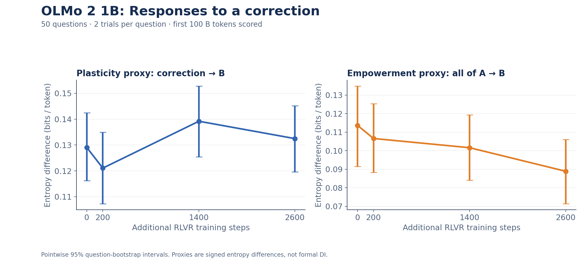
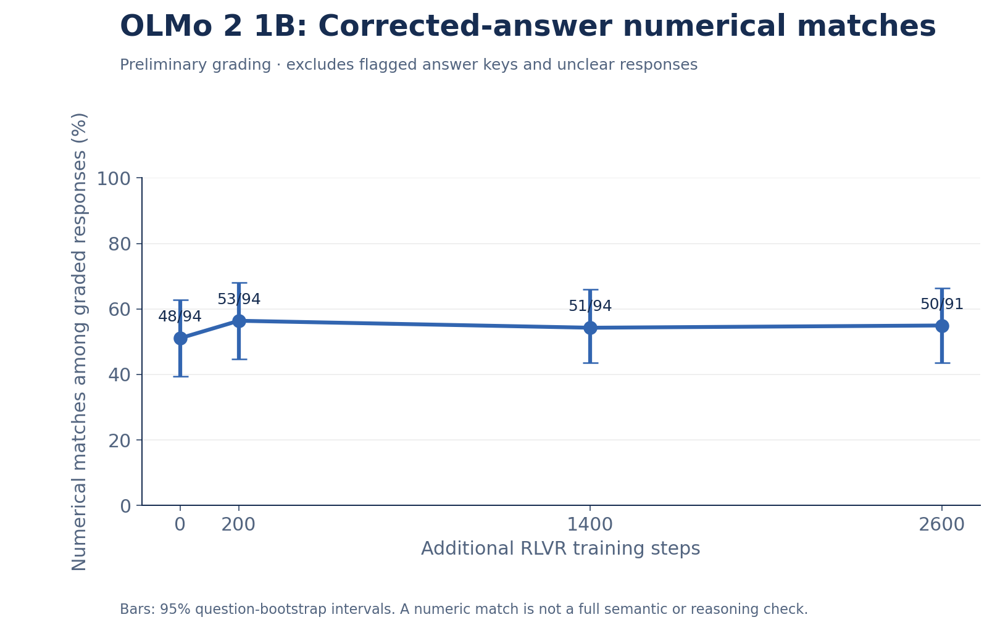

# OLMo 2 1B — fresh A, full B, first-100-token scoring

Completed 400 evaluations: 50 questions × two trials × four frozen checkpoints
(0/200/1400/2600 additional RLVR steps). A is sampled up to 100 tokens; B reaches
EOS or a 2,048-token safety cap. Scores use available B1–100, excluding EOS.
The earlier-output baseline removes all A, preserving question, correction,
message framing, and the exact B history. Step 0 is an already-trained DPO model.

Correction entropy means: 0.12904, 0.12107, 0.13920, 0.13249.
Earlier-output entropy means: 0.11362, 0.10656, 0.10160, 0.08890 bits/token.
These are sensitivity proxies, not formal DI or validated empowerment.

Grading is preliminary numerical matching with recorded manual conclusion
reviews, not comprehensive semantic checking. Source issues and ambiguous
answers are excluded. It is not standard GSM8K benchmark accuracy.

- `rollouts.parquet`: all 400 actual A/B token sequences, decoded responses,
  context entropy arrays, injection text, targets, and checkpoint identifiers.
- `question_means.parquet`, `summary.json`: grouped results.
- `analysis/`: figures, numerical intervals, grading records, exploratory windows.
- `configs/`: original per-checkpoint configuration and exact model revisions.
- `source_snapshot/`: original runner, helpers and inputs, archived for provenance;
  cloud controllers and credentials are not required for analysis.

[Full interpretation and limitations](../../docs/updates/2026-11-10.md).
