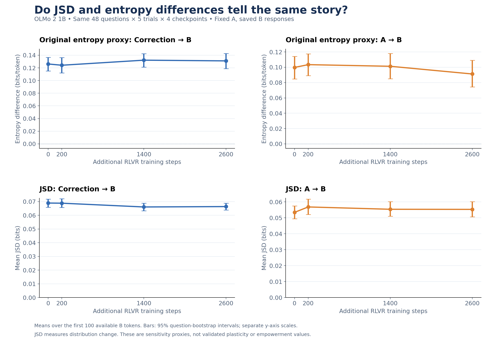

# OLMo 2 1B — JSD versus entropy on matched saved responses

Completed November 9, 2026. 960 responses: 48 questions × five trials × checkpoints
0/200/1400/2600. Source: [stopped fixed-A run](../olmo2_1b_fixed_step0_a_50q_5trials_20261106/README.md).
No new answers were generated. We teacher-forced the same saved B histories in
full, empty-correction and empty-A contexts, retaining message framing.
Scores cover the first 100 available non-EOS B tokens. Full A is removed for the
A comparison, not just a late span. Exact frozen revisions are recorded in the
source run's configs and in `validation/`.

| Measurement | Step 0 | Step 200 | Step 1400 | Step 2600 |
|---|---:|---:|---:|---:|
| Correction entropy difference | 0.12614 | 0.12416 | 0.13214 | 0.13104 |
| Earlier-output entropy difference | 0.09976 | 0.10341 | 0.10127 | 0.09122 |
| Correction JSD | 0.06896 | 0.06886 | 0.06610 | 0.06638 |
| Earlier-output JSD | 0.05343 | 0.05682 | 0.05536 | 0.05529 |




| Measurement | Step 2600 − step 0 | Paired 95% interval |
|---|---:|---:|
| Correction entropy difference | +0.004901 | [-0.006323, +0.016100] |
| Earlier-output entropy difference | -0.008541 | [-0.021698, +0.005550] |
| Correction JSD | -0.002577 | [-0.005328, +0.000230] |
| Earlier-output JSD | +0.001862 | [-0.001741, +0.005415] |


All endpoint intervals include zero. Intervals are exploratory paired
question-bootstrap 95% intervals (10,000 resamples), without multiplicity
adjustment. Average tokens within responses, then trials within questions, then
questions equally. JSD has opposite endpoint directions from entropy in this
sample, but does not establish a general plasticity/empowerment tradeoff.
Entropy differences measure uncertainty change; JSD measures distribution change.
Neither establishes correctness or formal information-flow empowerment.

## Files and reproducible analysis

- `jsd_scores.parquet`: all 960 per-token JSD arrays, means, original entropy
  means and entropy reproduction errors.
- `matched_rollouts.parquet`: exact matched saved A/B tokens, readable text,
  original entropy arrays, questions and corrections.
- `analysis/`: graph PNG/PDF, checkpoint CSV, paired endpoint CSV, JSON report,
  and the preliminary correction-value screen.
- `validation/`: per-checkpoint validation receipts and scoring configuration.
  Receipt hashes refer to original worker JSONL serialization; the publication
  manifest separately hashes the packaged Parquet artifacts.
- `source_snapshot/`: immutable original scorer and analysis sources. These are
  provenance artifacts; use the portable analysis entry points below.
- `manifest.json`: original matching selection and source hashes; source path
  is made repository-relative for publication.

From the repository root, with `requirements-analysis.txt` installed:

```sh
python analysis/olmo_jsd/analyze_jsd.py --run results/olmo2_fixed_a_jsd_20261109
python analysis/olmo_jsd/audit_injection_mentions.py --run results/olmo2_fixed_a_jsd_20261109
python analysis/olmo_jsd/verify_publication.py
```

The first two commands regenerate analysis files without loading a model or
starting Daytona. The verifier checks counts, entropy arithmetic, matching,
fixed-A identity, JSD bounds and consistency with saved publication summaries.
Original next-token probability vectors were recomputed during the rescore;
they are not stored in full. Token IDs, text, entropies and JSD arrays are stored.

The quick full-B screen excludes two flagged source questions: 920 responses
remain. Seven manually confirmed old-value uses are lower bounds; the 910
responses mentioning revised values are not comprehensively semantically
reviewed. See [full update](../../docs/updates/2026-11-10.md) before interpreting
the screen as correction-following behavior.
