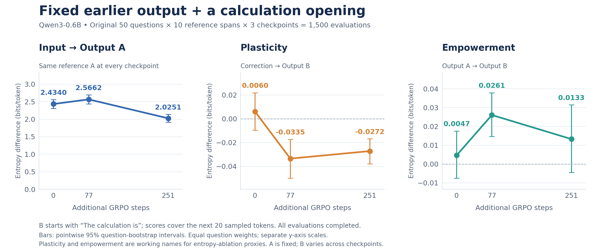

# Fixed A with a supplied calculation opening

Completed October 31, 2026. All 1,500 evaluations reached both 20-token horizons: original 50 GSM8K cases, ten saved reference A spans per case, and three pinned Qwen3-0.6B checkpoints. The first ten baseline A spans from the published 12,000-rollout run are reused by exact token ID at every checkpoint. Question/correction text is unchanged.

B receives `The calculation is` (token IDs 785, 21937, 374) as supplied assistant content in every full/ablated context. Only the next 20 sampled tokens are scored. B is independently sampled at each checkpoint; this is fixed-A scoring, not full B teacher forcing. Sampling uses temperature 1, no filtering, EOS enabled, and the existing Qwen3 non-thinking framing.



| Measurement (bits/token) | Step 0 | Step 77 | Step 251 |
|---|---:|---:|---:|
| Input to reference A | 2.433963 | 2.566186 | 2.025137 |
| Correction to B (plasticity working measure) | 0.005974 | -0.033450 | -0.027162 |
| A to B (empowerment working measure) | 0.004656 | 0.026052 | 0.013267 |

Correction scores decrease from 0 to 77 (adjusted p=0.006242) and 0 to 251 (p=0.004424); the later recovery is not significant (p=0.811762). A-to-B scores increase from 0 to 77 (p=0.018478), but neither 0-to-251 (p=0.811762) nor 77-to-251 (p=0.606811) passes the adjusted threshold. All three input comparisons pass the threshold. Tests pair 50 question means and apply Holm correction across nine tests. Bars are pointwise 95% intervals from 50,000 paired-question bootstrap draws, not simultaneous intervals.

The new design changes both A reuse and the B opening relative to the previous sampled-A study. It cannot attribute differences to the opening alone. A separate fixed-A/no-opening control was launched November 1; it is not included in these completed results. Supplied baseline reasoning may favor that model's text distribution. The proxies measure entropy changes, not formal DI/channel capacity or correction adoption. Negative scores indicate higher entropy with the source included. Full-answer accuracy is not measured.

## Files and verification

Raw token IDs, entropy arrays, completion flags, opening IDs and reference seeds are in `rollouts.parquet`. Equal-weight question summaries are in `question_means.parquet`. Configuration includes reference-file and runner hashes. The local saved-data verifier recomputed the full grid, source fields, entropy arithmetic and summaries. Additional validation checked all 1,500 exact A matches against baseline references, opening IDs and 20-token score windows; source hashes matched the archived launch snapshot.

From repository root:

```sh
python analyze_checkpoint_statistics.py \
  --results-dir results/qwen06b_original50_fixed_a_calculation \
  --input data/gsm8k200/gsm8k200_injections.parquet
python results/qwen06b_original50_fixed_a_calculation/plot_results.py
```

See `FIXED_A_OPENING.md` for the inference command and protocol. The run's exact reference source is `results/qwen06b_gsm8k200_20rollouts/rollouts.parquet`, step 0, trial indices 0-9. Existing sampled-A defaults remain supported.
